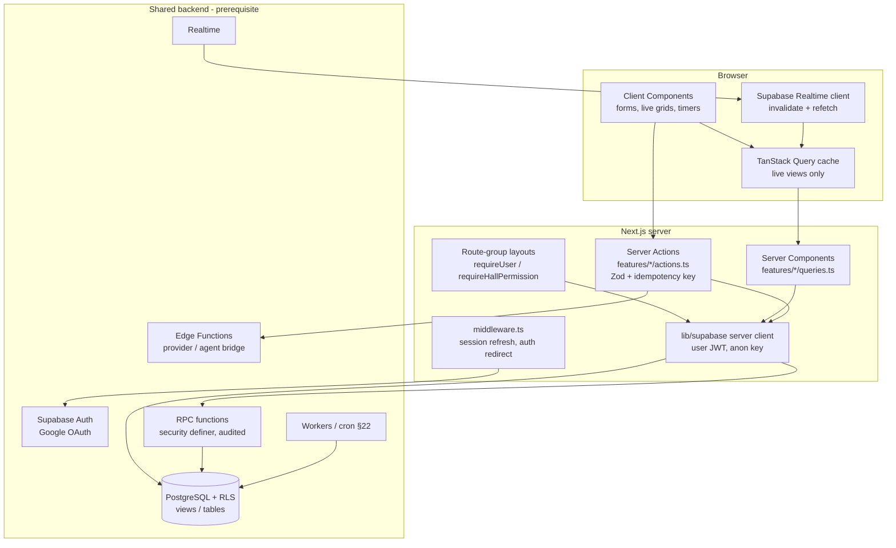

# Web Dashboard — Architecture

> Scope: the Next.js web dashboard in `web/` only. Source of truth: `Gaming_Hall_SaaS_Master_Specification.pdf` v2.0 (cited as §N).
> Status legend: **[SPEC]** confirmed by the specification · **[REC]** recommendation by this plan · **[ASSUMPTION]** working assumption pending approval.

## 1. Current state (inspected 2026-10-24)

| Item | Finding |
|---|---|
| `web/` | Empty. No Next.js project, no `package.json`, no source. |
| `backend/` | Empty. No Supabase project, migrations, RLS, RPCs or Edge Functions exist. |
| `mobile/` | Empty; out of scope. |
| `windows-agent/` | Empty. Now **planned**: Windows Agent + Hall Local Server (.NET 10). See [windows-agent/WINDOWS_AGENT_ARCHITECTURE_COMPARISON.md](windows-agent/WINDOWS_AGENT_ARCHITECTURE_COMPARISON.md). The cloud is reached only through the `agent-bridge` Edge Function; no service-role key on any PC. |
| Repository | Not a git repository. |

Consequence: every backend capability the web needs is a **prerequisite** (see `WEB_API_AND_DATA_CONTRACTS.md` §6, `BE-PREREQ-*`). The web is built against explicit contracts and a local Supabase instance.

## 2. Technology decisions

| Area | Choice | Basis | Rationale |
|---|---|---|---|
| Framework | Next.js (App Router), React | [SPEC] §2.1 | Server Components for authorized reads, layouts for protected areas. Pin latest stable major at setup (≥15). |
| Language | TypeScript, `strict: true`, `noUncheckedIndexedAccess` | [SPEC] §2.1 + [REC] | Type safety around money and IDs. |
| Styling / icons | Tailwind CSS, Lucide | [SPEC] §2.1 | — |
| Component primitives | shadcn/ui (Radix-based, copied into repo) | [REC] | Accessible primitives, no runtime dependency lock-in; fits Tailwind. |
| Auth | Supabase Auth, Google OAuth only, `@supabase/ssr` cookie sessions | [SPEC] §2.3, §5 | Server-validated sessions in middleware, Server Components and Server Actions. Phone/SMS OTP excluded (§5.1). |
| Data access | `@supabase/supabase-js` with the **user's** JWT; reads via RLS-protected views/tables; mutations via Postgres RPC or Edge Functions | [SPEC] §20, §21 + [REC] | DB enforces tenant isolation; web never holds privileged credentials on request paths. |
| DB types | `supabase gen types typescript` → `src/contracts/database.ts` | [REC] | Single generated contract shared conceptually with Flutter/Agent. |
| Mutations | Next.js Server Actions calling RPCs, returning a typed `ActionResult` | [REC] | Keeps tokens server-side, enables CSRF-safe POST, central error mapping. |
| Client cache / realtime | TanStack Query only for live views (device grid, active sessions, command center); Supabase Realtime triggers invalidation/refetch | [SPEC] §17.1 + [REC] | "Events are delivery mechanisms, not authority" — always refetch. |
| Forms / validation | React Hook Form + Zod (schemas shared between client and Server Action) | [REC] | UX validation only; DB/RPC revalidates. |
| Tables | TanStack Table with server-side pagination/filter/sort | [REC] | Large histories (sessions, invoices, ledgers, audit). |
| Calendar | Custom resource-timeline grid (device × time) built on CSS grid | [REC] | Avoids heavy calendar library; requirement is a device-time view. Re-evaluate if scope grows. |
| Charts | Recharts | [REC] | Simple report charts; lazy-loaded. |
| Dates | `date-fns` + `date-fns-tz`; hall time zone from `halls.time_zone` | [SPEC] §7.1 + [REC] | All times rendered in the hall's time zone. |
| Money | Integer minor units + currency from API; `Intl.NumberFormat` display only | [SPEC] §10.2 | No financial calculation in the browser. |
| i18n | `next-intl` scaffolding, English first | [ASSUMPTION] | Target market undecided (§27 payment provider); cheap to add early. |
| Unit/component tests | Vitest + React Testing Library + MSW | [REC] | |
| E2E | Playwright against local Supabase with seeded tenants | [REC] | |
| A11y | axe-core (`@axe-core/playwright`), eslint-plugin-jsx-a11y | [REC] | |
| Quality | ESLint (next + typescript-eslint strict), Prettier, `tsc --noEmit`, Husky + lint-staged | [REC] | |
| CI | GitHub Actions | [ASSUMPTION] | Repo host not chosen yet. |
| Hosting | Vercel | [SPEC] §2.1 ("Vercel or suitable") | Preview deployments per PR against staging Supabase. |
| Monitoring | Sentry (errors + performance), Vercel Analytics | [REC] | §23.2 monitoring; scrub PII/tokens. |

Not introduced: Redux/Zustand (server state + URL state suffice), an ORM (Supabase client + generated types), a custom REST server in Next.js for business logic (would duplicate backend rules).

## 3. Responsibility split

| Concern | Web (frontend) | Backend (Supabase/Postgres/Edge Functions/workers) |
|---|---|---|
| Identity | Start Google OAuth, handle callback, refresh session cookie | Validate identity, create profile, expose `me_permissions` |
| Authorization | Route guards, hide/disable controls (UX only) | RLS + permission checks inside every RPC (authoritative) |
| Tenant isolation | Pass `hallId` from URL as a *request*, never as proof | RLS on hall membership; RPC rejects foreign hall |
| Availability / conflicts | Display, pre-validate form shape | Exclusion constraints, transactional revalidation (§8.2) |
| Pricing, invoice totals, wallet balances | Display server values | Compute, snapshot, store (§10, §11, §12) |
| Payments, refunds, withdrawals, shift close | Collect intent + idempotency key, show result | Atomic, idempotent, audited operation (§19) |
| Agent commands | Request command, show status timeline | Record, dispatch, track state, timeout (§15) |
| Timers / jobs | Visual countdown only | Durable jobs (§22); browser timers never authoritative |
| Audit | Display, filter | Write audit events in same transaction |

## 4. Directory structure (planned)

```
web/
  src/
    app/
      (public)/login/page.tsx
      auth/callback/route.ts            # OAuth code exchange
      auth/signout/route.ts             # POST only
      (gate)/no-access/page.tsx
      (gate)/select-hall/page.tsx
      (app)/layout.tsx                  # authenticated shell; loads me + memberships
      (app)/account/page.tsx
      (app)/notifications/page.tsx
      (app)/halls/[hallId]/layout.tsx   # hall guard: membership + permission set for hall
      (app)/halls/[hallId]/page.tsx     # overview
      (app)/halls/[hallId]/devices/...  # see route inventory
      (app)/admin/layout.tsx            # platform guard (super admin)
      (app)/admin/...
      (app)/sales/layout.tsx            # sales guard (sales agent / sales admin)
      (app)/sales/...
      api/health/route.ts
      error.tsx, not-found.tsx, forbidden.tsx (via helper)
    features/                           # one folder per module
      halls/ devices/ reservations/ sessions/ pricing/ invoices/ payments/
      wallets/ refunds/ shifts/ expenses/ reports/ employees/ agents/
      risks/ notifications/ audit/ admin/ sales/
        components/  queries.ts  actions.ts  schemas.ts  types.ts  __tests__/
    components/
      ui/            # shadcn primitives
      shell/         # Sidebar, Topbar, HallSwitcher, Breadcrumbs
      data/          # DataTable, FilterBar, Pagination, EmptyState, ErrorState
      domain/        # Money, StatusBadge, HallTime, PermissionGate, ConfirmDialog, ReasonDialog
    lib/
      supabase/server.ts client.ts middleware.ts   # anon key + user JWT only
      auth/session.ts permissions.ts guards.ts     # requireUser, requireHallPermission
      actions/result.ts errors.ts idempotency.ts   # ActionResult, error mapping, key generation
      money.ts dates.ts env.ts logger.ts
    contracts/
      database.ts       # generated
      permissions.ts    # permission identifier union (from §4.7 + final matrix)
      enums.ts          # status enums mirrored from DB
  middleware.ts
  tests/e2e/  tests/fixtures/  tests/msw/
  docs/planning/
```

Rules:
- `features/*/queries.ts` and `actions.ts` are `server-only`. Client components receive serialized data.
- No `features/*` module imports another module's internals; shared items move to `components/domain` or `lib`.
- No service-role key in `web/` env for request-handling code. If a server-only admin task is ever required, it lives in backend, not the dashboard (ADR-004).

## 5. Route inventory

Hall routes are prefixed `/halls/[hallId]`. "Perm" uses §4.7 identifiers; final matrix pending (DEC-01).

| Route | Purpose | Roles | Key perm | MVP |
|---|---|---|---|---|
| `/login` | Continue with Google | anonymous | — | Yes |
| `/auth/callback` | OAuth code exchange | — | — | Yes |
| `/no-access` | Authenticated but no privileged role (e.g. customer) | any | — | Yes |
| `/select-hall` | Choose among memberships | Employee, Owner | membership | Yes |
| `/account` | Own profile, sign out | all staff | — | Yes |
| `/notifications` | In-app notifications | all staff | — | Later |
| `/halls/[hallId]` | Hall overview KPIs | Employee, Owner | `device.view` | Yes |
| `…/devices` | Live device grid | Employee, Owner | `device.view` | Yes |
| `…/devices/new`, `…/devices/[deviceId]/edit` | Device CRUD | Owner | `hall.settings.manage` | Yes |
| `…/devices/[deviceId]` | Device detail, maintenance, commands | Employee, Owner | `device.view` / `device.control` | Yes |
| `…/reservations` | Calendar (device × time) + queue | Employee, Owner | `reservation.view` | Yes |
| `…/reservations/[reservationId]` | Detail, check-in, cancel | Employee, Owner | `reservation.*` | Yes |
| `…/waiting-list` | Waiting list queue | Employee, Owner | `reservation.view` | Later (DEC-04) |
| `…/sessions` | Active sessions & timers, walk-in | Employee, Owner | `session.*` | Yes |
| `…/sessions/history` | Session history | Employee, Owner | `session.*` view | Yes |
| `…/sessions/[sessionId]` | Detail, extend, convert, end | Employee, Owner | `session.*` | Yes |
| `…/invoices` | Invoices, outstanding filter | Employee, Owner | `invoice.view` | Yes |
| `…/invoices/[invoiceId]` | Detail, collect payment | Employee, Owner | `invoice.view`, `payment.collect` | Yes |
| `…/payments/[paymentId]` | Payment detail, refund request | Employee, Owner | `invoice.view`, `refund.request` | Yes |
| `…/refunds` | Refund requests & approvals | Owner (+ permitted) | `refund.request`/`refund.approve` | Yes (basic) |
| `…/adjustments` | Financial adjustments/reversals | Owner | `payment.adjust` | Yes (basic) |
| `…/wallets` | Hall wallets list | Owner, permitted Employee | `wallet.view` | Yes |
| `…/wallets/[walletId]` | Ledger, top-up, withdrawal request, freeze | Owner, permitted Employee | `wallet.*` | Yes |
| `…/pricing` | Rates, pricing windows | Owner | `hall.settings.manage` | Yes |
| `…/packages` | Packages | Owner | `hall.settings.manage` | Basic |
| `…/discounts` | Discounts | Owner | `hall.settings.manage` | Basic |
| `…/shifts` | Shift list, open shift | Employee, Owner | `shift.open` | Yes |
| `…/shifts/[shiftId]` | Shift detail, unpaid gate, close | Employee, Owner | `shift.close` | Yes |
| `…/registers` | Cash registers & movements | Owner | `shift.*` / financial | Basic |
| `…/expenses` | Expenses | Owner | financial (DEC-15) | Later |
| `…/reports` | Operational/financial reports | Owner | `report.financial.view` | Basic |
| `…/employees` | Employees & permissions, invitations | Owner | `employee.manage` | Yes |
| `…/employees/[membershipId]` | Edit roles/permissions, deactivate | Owner | `employee.manage` | Yes |
| `…/my-activity` | Employee's own activity | Employee | — | Yes |
| `…/agents` | Agent health | Owner, permitted Employee | `device.view` | Yes |
| `…/commands` | Command history / center | Owner, permitted Employee | `device.view` | Yes |
| `…/risks` | Reservation risk monitor | Employee, Owner | `reservation.view` | Later |
| `…/settings` | Hall profile, hours, policies, payment methods | Owner | `hall.settings.manage` | Yes |
| `…/audit` | Hall audit log | Owner | audit view (DEC-01) | Yes |
| `/admin` | Platform overview metrics | Super Admin | `platform.tenants.manage` | Yes (basic) |
| `/admin/tenants`, `/admin/tenants/[tenantId]` | Tenants, branches/halls, activation | Super Admin | `platform.tenants.manage` | Yes |
| `/admin/users` | Accounts & role assignment | Super Admin | `platform.tenants.manage` | Yes |
| `/admin/search` | Authorized cross-hall search (audited) | Super Admin | platform | Later |
| `/admin/monitoring` | Agent/jobs/payment-discrepancy health | Super Admin | platform | Later |
| `/admin/settings` | Platform configuration | Super Admin | platform | Later |
| `/admin/audit` | Platform audit log | Super Admin | platform | Yes |
| `/sales` | Sales home | Sales Agent, Sales Admin | `sales.leads.manage` | Phase W10 |
| `/sales/leads`, `/sales/leads/[leadId]` | Leads & onboarding submissions | Sales Agent, Sales Admin | `sales.leads.manage` | W10 |
| `/sales/attribution` | Attribution & disputes | Sales Admin | sales admin | W10 |
| `/sales/agents` | Manage sales agents | Sales Admin | sales admin | W10 |
| `/sales/reports` | Sales performance/conversion | Sales Admin | sales admin | W10 |

Out of scope: optional customer-facing web pages (§2.1) — deferred, see DEC-W03.

## 6. Layer diagram



## 7. Authentication & authorization boundaries

1. `middleware.ts`: refreshes the Supabase session cookie; unauthenticated requests to `(app)` redirect to `/login?next=…` (only same-origin relative `next` allowed).
2. `(app)/layout.tsx`: `requireUser()` → calls `get_my_context()` RPC returning profile, status, platform roles, hall memberships with permission sets. Inactive profile → sign out + `/no-access`. No privileged role → `/no-access`.
3. `halls/[hallId]/layout.tsx`: `requireHallMembership(hallId)` → 404 (not 403, to avoid hall enumeration) if no membership.
4. Each page: `requireHallPermission(hallId, 'invoice.view')` → renders shared `Forbidden` component (HTTP 403 semantics) on failure.
5. Each Server Action: re-check permission (UX fast-fail) then call RPC, which **is the authoritative check**. RPC errors `42501`/custom `PERMISSION_DENIED` map to a forbidden result.
6. `PermissionGate` component hides/disables controls; never the sole enforcement.
7. Permission context is cached per request (`React.cache`), not across requests; role changes take effect on next navigation. Sensitive actions additionally rely on RPC checks so revocation is immediate.

## 8. Data access patterns

- **Reads**: Server Components call `features/x/queries.ts` → Supabase select on RLS-protected views (e.g. `v_device_live_status`, `v_invoice_summary`). Pagination via `range()`, filters in URL search params.
- **Mutations**: `actions.ts` → `supabase.rpc('fn_name', {..., p_idempotency_key})` → returns typed result → `revalidatePath` / query invalidation.
- **Live views**: initial data from RSC, hydrated into TanStack Query; Realtime subscription (channel scoped to hall, RLS-authorized) triggers `invalidateQueries`; on reconnect, full refetch (§17.1).
- **Idempotency**: client generates a UUID v4 per *user intent* when a financial/session form opens; it is reused for retries of that intent and regenerated only after a confirmed success or explicit user restart.

## 9. Validation & error handling

- Zod schemas in `features/x/schemas.ts` used by RHF (client) and the Server Action (server). DB constraints remain final.
- `ActionResult<T> = { ok: true, data: T } | { ok: false, code: ErrorCode, message: string, fieldErrors?: Record<string,string> }`.
- `ErrorCode`: `UNAUTHENTICATED | FORBIDDEN | NOT_FOUND | VALIDATION | CONFLICT | STALE_STATE | DUPLICATE | PRECONDITION_FAILED | UNAVAILABLE | UNKNOWN`. Mapping from Postgres SQLSTATE / RPC error codes lives in `lib/actions/errors.ts`.
- User messages never include SQL, stack traces, tokens or other tenants' identifiers. Full details go to Sentry with scrubbing.
- Every route has `loading.tsx` (skeleton), `error.tsx` (retry + support reference ID), and empty states via `EmptyState`.

## 10. Environment configuration

| Variable | Exposure | Notes |
|---|---|---|
| `NEXT_PUBLIC_SUPABASE_URL` | public | per environment |
| `NEXT_PUBLIC_SUPABASE_ANON_KEY` | public | RLS-guarded |
| `NEXT_PUBLIC_APP_URL` | public | OAuth redirect base |
| `SENTRY_DSN`, `SENTRY_AUTH_TOKEN` | server/build | |
| `APP_ENV` | server | development / test / staging / production (§23.1) |

`lib/env.ts` validates with Zod at boot; build fails if a `SUPABASE_SERVICE_ROLE_KEY` is referenced from `src/` (lint rule + CI grep, SEC-003). Google OAuth client secret lives only in Supabase Auth settings.

## 11. Logging & monitoring

- `lib/logger.ts`: structured JSON logs on server (request id, user id hash, hall id, action name, outcome, duration); no tokens, emails, or payment details.
- Sentry: server + client, `beforeSend` scrubbing, release tagging, performance traces on Server Actions.
- `/api/health` returns build version and Supabase reachability (no secrets).

## 12. Testing structure

- `src/**/__tests__/*.test.ts(x)` — unit/component (Vitest, RTL, MSW).
- `tests/integration/` — Server Actions/queries against local Supabase with seeded tenants and users per role.
- `tests/e2e/` — Playwright specs per critical workflow, auth via seeded sessions (test-only login helper on local Supabase; Google is mocked only in E2E env).
See `WEB_TESTING_STRATEGY.md`.
