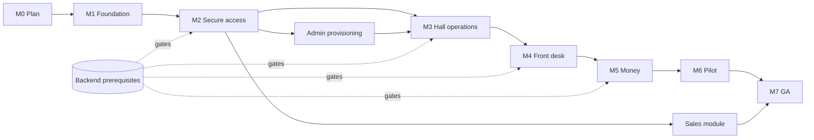

# Web Milestones & Estimates

Estimates are engineer-days for the web dashboard only; they exclude backend, mobile and Agent work. They are ranges because 17 business decisions (§27) and the whole backend are still open.

## 1. Effort by phase

| Phase | Scope | Task effort (d) | With 25 % integration/review (d) | Range |
|---|---|---|---|---|
| W0 | Decisions & plan sign-off | 2 | 2–3 | 2–3 |
| W1 | Setup & standards | 6 | 7 | 6–9 |
| W2 | Design system & shell (+API foundations) | 12.5 | 14–16 | 12–18 |
| W3 | Authentication | 7 | 9 | 7–11 |
| W4 | Tenancy, permissions, authz framework | 10 | 12 | 10–15 |
| W5 | Hall settings, employees, overview, audit | 14 | 18 | 15–21 |
| W6 | Devices, maintenance, Agent visibility | 12 | 15 | 12–18 |
| W7 | Reservations & sessions | 19.5 | 24 | 20–30 |
| W8 | Pricing, invoices, payments, wallets | 25 | 32 | 26–38 |
| W9 | Shifts, registers, reports | 9.5 | 12 | 10–15 |
| W10 | Admin (MVP), sales, P2 features | 7 + 8.5 + ~18 | 9 + 10 + 22 | — |
| W11 | Integration, security, performance | 8 | 10 | 8–14 |
| W12 | Deployment & pilot release | 4.5 | 6 | 5–8 |

**Totals**
- **MVP (P0 only, incl. admin provisioning)**: ≈ 125 task-days → **≈ 150–170 engineer-days**.
- **Pilot-ready (P0 + P1, incl. sales)**: ≈ 185–205 engineer-days.
- **Full plan incl. P2**: ≈ 210–235 engineer-days.

Calendar view (assuming backend keeps ahead): 2 web engineers → MVP in ~16–19 weeks; 3 engineers → ~12–14 weeks (limited by critical path W4→W7→W8).

## 2. Milestones

| Milestone | Contents | Exit criteria |
|---|---|---|
| M0 Plan approved | W0 | DEC-01, DEC-17, DEC-W01 owners/dates set |
| M1 Foundation | W1 + W2 | CI green, shell + components, preview deploys |
| M2 Secure access | W3 + W4 | Google login per env; authz matrix in CI; cross-tenant tests pass |
| M3 Hall operations | W5 + W6 + admin provisioning | Owner can be provisioned, configure hall, devices, employees; live grid |
| M4 Front desk | W7 | Check-in, walk-in, extend, end; E2E-02 green |
| M5 Money | W8 + W9 | Payments, wallets, refunds, shifts, basic reports; financial E2E green |
| M6 Pilot | W11 + DEPLOY-005 | Pre-pilot gates; one hall live on staging/prod |
| M7 GA | DEPLOY-006 + sales | Pilot feedback fixed; sales module enabled |

## 3. Suggested MVP (web slice of spec §26.1)

Included:
- Google sign-in, profile, role/permission-aware navigation, hall switcher, no-access handling.
- Hall settings (profile, hours, policies, currency/methods), employees with invitations and permissions.
- Device management, live grid with distinct states, maintenance, Agent health, device commands, command history.
- Reservation calendar/queue, check-in (with late override), cancellation, no-show display.
- Fixed/open/walk-in sessions, timers, extension, end → invoice.
- Rate configuration; invoice list/detail; outstanding invoices; cash and wallet payments; wallet ledger & cash top-up; refund request/approval; adjustments/reversals.
- Shifts: open, unpaid gate, close with discrepancy; basic financial/operational report.
- Hall and platform audit logs; super-admin tenant/hall provisioning, activation, user roles.
- Realtime updates with refetch.

Deferred (P1/P2): staff-created advance reservations, pricing windows, packages, discount management UI, withdrawals, wallet freeze, registers beyond one per hall, CSV export, sales module, notifications page, risk monitor, waiting list, expenses, advanced reports, cross-hall search, platform monitoring/settings, online payments, customer-facing web pages.

## 4. Estimate assumptions
- Backend RPCs/views available per `WEB_IMPLEMENTATION_PLAN.md` §4; otherwise web work proceeds on MSW but phases cannot close.
- One designer-light approach (shadcn defaults + tokens); custom branding adds 5–10 days.
- Decisions resolved before the phase that needs them; each late decision costs ~1–3 days of rework.
