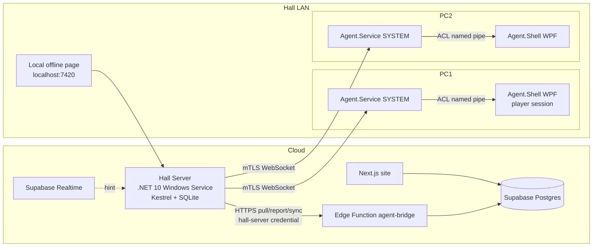

# Windows Agent — Architecture Comparison & Final Recommendation

Status: **Planning only.** No code, migrations, installers or Windows policies are produced by this document set.

Related: [Spike](WINDOWS_AGENT_TECHNICAL_SPIKE.md) · [Security](WINDOWS_AGENT_SECURITY_MODEL.md) · [Command contract](WINDOWS_AGENT_COMMAND_CONTRACT.md) · [Offline & recovery](WINDOWS_AGENT_OFFLINE_AND_RECOVERY.md) · [Test plan](WINDOWS_AGENT_TEST_PLAN.md) · [Decisions & risks](WINDOWS_AGENT_DECISIONS_AND_RISKS.md)

## 1. Starting point (current repo)
- The database already has `agents`, `agent_commands`, `agent_command_events`, `v_device_live_status`, `request_device_command` and `queue_agent_command`. They are defined in `backend/supabase/migrations/20261024000004_devices_maintenance_agents.sql`, and migrations `…0005` and `…0007` extend them.
- Starting or ending a session already queues `START_SESSION`/`END_SESSION`.
- The web app already has `features/devices/actions.ts` (`requestCommandAction`), `DeviceActions.tsx`, and the Agents and Commands pages.
- Missing pieces:
  - The agent itself (`windows-agent/` is empty).
  - Pairing and credentials.
  - The agent-facing RPCs: heartbeat, pull, report and sync.
  - Command timeout and expiry.
  - A command payload.
  - A command sequence and session revision.

## 2. Topology options

| Option | Description | Offline continuity | LAN delivery | Complexity | Verdict |
|---|---|---|---|---|---|
| A. Agent → Cloud direct | Each PC talks to Supabase through an Edge Function | Running sessions only (local timer) | No | Low | Rejected: offline starts aren't possible |
| B. Agent → Hall Server → Cloud | The cashier PC relays commands and buffers offline operations | Full (continue/start/extend/end) | Yes | Medium | **Chosen** |
| C. Agent → Cloud, falls back to the Hall Server | Two paths | Full | Partial | High (two code paths) | Rejected |
| D. Leader election among agents | No dedicated server | Full | Yes | Very high | Rejected for the MVP |

## 3. Station control (kiosk) options

| Mechanism | Edition / licensing | Steam / launchers / anti-cheat | Real boundary? | Notes |
|---|---|---|---|---|
| Assigned Access, single-app | Pro/Enterprise/Edu | ❌ Only one app can run, so games can't launch | Yes (OS-enforced) | Unsuitable for gaming |
| Assigned Access, multi-app (Win11) | Pro (22H2+)/Enterprise/Edu | ⚠️ Every game exe needs an allow-list entry. Launchers spawn child processes and update their exes | Yes | Maintenance burden. Future evaluation |
| Shell Launcher v2 | **Enterprise/Education/IoT Enterprise only** (not Pro) | ✅ A custom shell can launch Steam | Partial (replaces explorer.exe) | Good fit, but licensing blocks most halls. Future option |
| Standard (non-admin) user + local GPO baseline | Any edition (GPO editor needs Pro or later) | ✅ Steam and most anti-cheat work under a standard user (to be validated) | Partial: real OS permissions | **Recommended base** |
| Custom WPF lock overlay | Any | ✅ | ❌ UX only | Used **for display only**, never as the security boundary |
| Low-level keyboard hook + DisableTaskMgr | Any | ✅ | ❌ Bypassable | Defence-in-depth during the lock only. Never applied automatically by the installer |

### Recommendation for gaming PCs
1. **Player account:** a local **standard user** that signs in automatically. The player is never an admin.
2. **Restrictions:** a documented **local GPO baseline** that a technician applies manually (see the security model). Examples: no Control Panel or Settings, no regedit or cmd, no software installs, no time changes. The installer never changes policies on its own.
3. **Lock screen:** the **WPF lock overlay** is the user experience: a top-most full-screen window on every monitor. It is not trusted to enforce anything.
4. **Real authority:** the **SYSTEM service**. If the UI is killed or bypassed, the service enforces the lock through `LockWorkStation` from the user context, and falls back to `WTSLogoffSession` or `WTSDisconnectSession`.
5. **Future, for Enterprise or IoT halls:** Shell Launcher v2 with the Shell app as the shell.

## 4. Final architecture

### Responsibilities
| Component | Owns | Never does |
|---|---|---|
| Cloud (Supabase) | Sessions, reservations, invoices, pricing, audit. **The final authority** | Talks to the PCs directly |
| Edge Function `agent-bridge` | Checks the hall-server credential, calls security-definer RPCs | Exposes the service-role key |
| Hall Server | Relays commands, durable outbox/inbox, cache (pricing, reservations), issues `session_revision`, offline page, local CA | Creates final invoices |
| Agent.Service (SYSTEM) | Lock state reconciler, session timer, power commands, persisted state | Runs arbitrary shell or PowerShell |
| Agent.Shell (WPF, user) | Displays the lock and timer, shows warnings | Holds credentials or privileged APIs |

## 5. Why the Hall Server is justified
- The requirement is that **work continues during an internet outage**. With option A, a new session can't start offline, because no local component can authorise it, record it and price it from a cache.
- Command delivery over the LAN keeps working when the internet is down. Delivery latency also no longer depends on the cloud.
- One cloud credential per hall, instead of N exposed PCs, shrinks the attack surface. Heartbeats are batched, so the cloud receives one request every 30 s instead of N.
- Cost: the cashier PC becomes a single point of failure for *new* operations. This is mitigated as described in [Offline & recovery](WINDOWS_AGENT_OFFLINE_AND_RECOVERY.md) §6, and the limits are stated explicitly.

## 6. MVP scope (exact)
- Pairing: a one-time code → a device credential and certificate.
- Lock and unlock, START_SESSION/END_SESSION with a countdown and warnings at 5 and 1 minutes, SHUTDOWN/RESTART with a 30 s on-screen warning, SYNC_STATE.
- Heartbeats (agent → server every 10 s; server → cloud as a batch every 30 s).
- Durable command delivery (pull with a cursor, plus a Realtime hint and reconciliation).
- A session revision per session, separate session and lock state machines, reboot recovery.
- Offline: continue, start (only with a fresh reservation cache), extend and end, with an immutable pricing snapshot and provisional amounts. Sync with `client_op_id` idempotency, plus a cloud conflict queue.
- Manager override for an expired cache (permission-gated, one session, 60 min cap, audited).
- Web: hall pairing-code generation, Hall Server status, unpair an agent, offline banner, conflict queue.
- Manually applied GPO baseline document, MSI installers (signed if a certificate is available).

## 7. Deferred (future)
- Shell Launcher v2 or Assigned Access profiles.
- Signed auto-update with rollback.
- Creating reservations offline.
- Screenshots, messages to the player, app inventory.
- HA or a standby Hall Server.
- Per-employee offline PIN.
- Console devices (PlayStation and similar have no agent).

## 8. Prioritised proof-of-concept plan
1. **PoC-1: IPC and lock.** The SYSTEM service launches the WPF lock into the auto-logon session, talks over a named pipe with an ACL, survives killing the UI, and passes the timing harness (≤2 s).
2. **PoC-2: reboot and time.** Persisted state and recovery, boot anchor, clock-change detection.
3. **PoC-3: LAN mTLS.** A local CA, pinning at pairing, spoofed mDNS is rejected.
4. **PoC-4: durable delivery.** Pull with a cursor and reconciliation through the Edge Function. Realtime is optional.
5. **PoC-5: offline sync.** Outbox replay ×3 yields exactly one session and one invoice. Pricing snapshot honoured.
6. **PoC-6: standard user and games.** Steam plus 3 popular anti-cheat titles (e.g. Valorant/Vanguard, FACEIT, EAC) run under the standard user with the GPO baseline.

## 9. Go / no-go criteria (before production implementation)
| # | Criterion | Go if |
|---|---|---|
| G1 | Local lock latency (healthy service and UI) | p95 ≤ 2 s over 200 runs |
| G2 | Lock after a network cut | Locks at end_at ±2 s with the LAN unplugged |
| G3 | Dangerous commands | 0 double SHUTDOWN/RESTART in the chaos suite |
| G4 | Sync idempotency | 0 duplicate sessions or invoices over 1,000 replayed operations |
| G5 | Stale revision | 0 executions of an outdated end time in the revision fuzz test |
| G6 | Reboot recovery | Never auto-unlocks when the state is uncertain (100% of the matrix) |
| G7 | Lock bypass | A standard user can't reach the desktop while locked (manual pen-test checklist) |
| G8 | Games | Steam plus the selected anti-cheat titles work under the standard user |
| G9 | .NET 10 | Every dependency in the spike checklist is confirmed |

Any **no-go** blocks the production build. G7 and G8 failures are reviewed before the MVP is cut back to "lock as UX only, with staff supervision".
