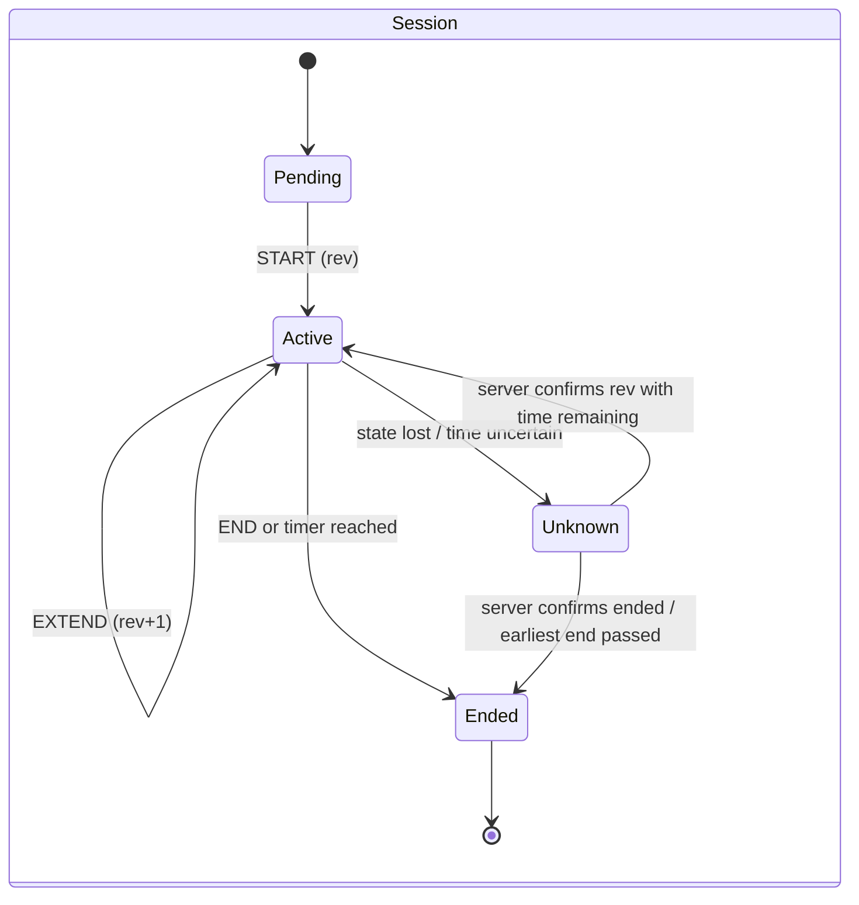
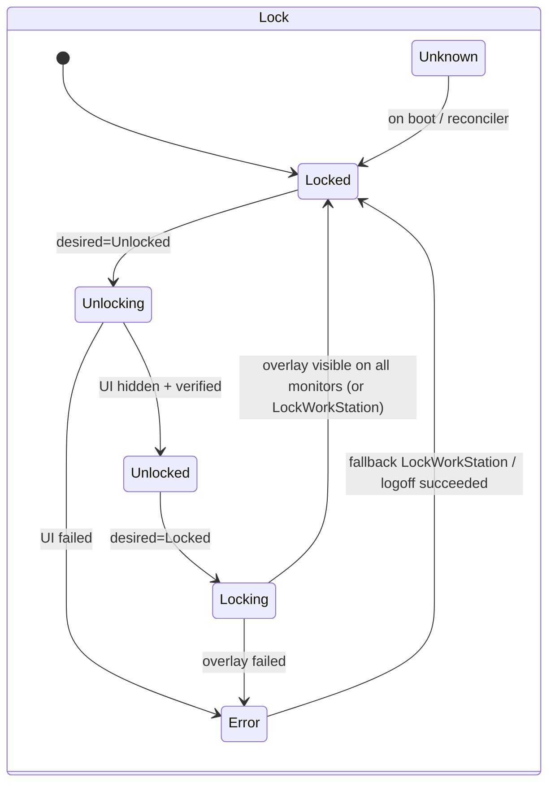
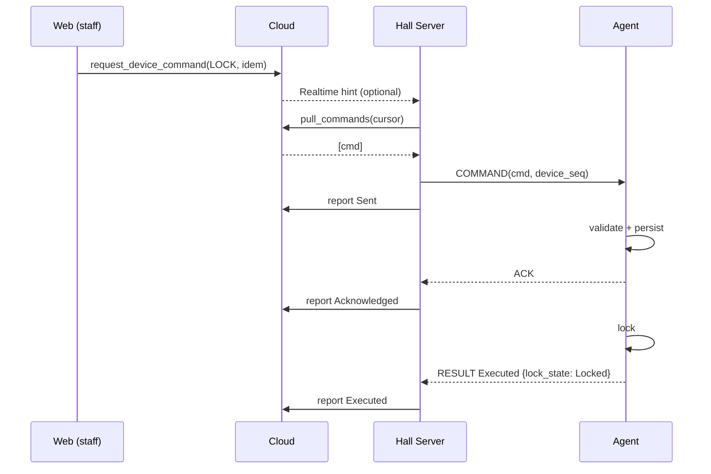

# Windows Agent — Command, Session & Sync Contract

Version: `payload_version = 1`. Shared types live in `Arcadia.Contracts` and mirror the Supabase generated types.

## 1. Command envelope

| Field | Type | Origin | Notes |
|---|---|---|---|
| `command_id` | uuid | Cloud (`agent_commands.id`) or Hall Server (offline-originated, uuid v7) | Primary identity. Dedup key on the agent |
| `client_op_id` | uuid v7 | The originator (web action, local page or server) | Unique in the DB, used for sync idempotency |
| `idempotency_key` | text | Requester (existing `request_device_command` contract) | Unique per `(requested_by, idempotency_key)` (existing) |
| `tenant_id` | uuid | = `hall_id` | Checked against the credential |
| `branch_id` | uuid? | Hall branch, if one exists | Checked against the credential |
| `station_id` | uuid | = `device_id` (the PC station) | |
| `agent_id` | uuid | The paired agent | Must match the certificate identity |
| `device_seq` | int64 | Hall Server, strictly increasing **per device** | Used for ordering |
| `created_at` | timestamptz (UTC, server clock) | | |
| `expires_at` | timestamptz | created_at + TTL (LOCK/UNLOCK 60 s, START/END 120 s, SHUTDOWN/RESTART 60 s, SYNC 30 s) | An expired command is never executed |
| `type` | enum | `START_SESSION, END_SESSION, EXTEND_SESSION, LOCK, UNLOCK, SHUTDOWN, RESTART, SYNC_STATE` | `EXTEND_SESSION` is new |
| `payload_version` | int | 1 | An unknown version is rejected with `UNSUPPORTED_VERSION` |
| `payload` | jsonb | see §3 | |
| `result` | jsonb? | Agent | e.g. `{lock_state, session_state, revision, boot_id}` |
| `failure_reason` | enum? | Agent or server | see §6 |

## 2. Command lifecycle

```mermaid
stateDiagram-v2
  [*] --> Queued
  Queued --> Sent: server delivered to agent
  Queued --> Canceled: staff cancel
  Queued --> Expired: now > expires_at before delivery
  Sent --> Acknowledged: agent accepted (validated, persisted)
  Sent --> TimedOut: no ack in 15 s (retry only if safe, see 5)
  Sent --> Rejected: agent refused (stale, unauthorized, expired, unsupported)
  Acknowledged --> Executed: action confirmed
  Acknowledged --> Failed: action error
  Acknowledged --> Unknown: no result in 60 s
  Unknown --> Executed: reconciled by SYNC_STATE
  Unknown --> Failed: reconciled by SYNC_STATE
  Executed --> [*]
  Failed --> [*]
  Canceled --> [*]
  Expired --> [*]
  Rejected --> [*]
  TimedOut --> [*]
```



DB impact (later migration, not part of this task): extend the `agent_commands.status` check with `Expired`, `Rejected` and `Unknown`. `TimedOut` and `Canceled` already exist.

## 3. Payloads (v1)

```jsonc
// START_SESSION / EXTEND_SESSION / END_SESSION
{ "session_id": "uuid", "session_revision": 7,
  "start_at_utc": "2026-11-05T14:00:00Z",   // server time
  "end_at_utc":   "2026-11-05T15:30:00Z",   // null for open-ended
  "duration_ms":  5400000,                  // authoritative for the monotonic countdown
  "warn_at_ms":   [300000, 60000] }
// LOCK / UNLOCK
{ "reason": "staff|session_end|maintenance", "session_id": "uuid|null", "session_revision": 7 }
// SHUTDOWN / RESTART
{ "grace_seconds": 30, "reason": "staff" }
// SYNC_STATE
{}
```

## 4. Session revision rules
- `session_revision` is an int64 issued by the **Hall Server**, strictly increasing per `session_id`. Start = 1, and every extend, modify or end adds 1.
- The agent persists `max_seen_revision[session_id]` together with the session record (see the offline doc §4).
- Acceptance rule on the agent:
  - `revision > max_seen` → apply and persist **before** acknowledging.
  - `revision == max_seen` and the same `command_id` → duplicate: return the stored result.
  - `revision <= max_seen` otherwise → **Rejected `STALE_REVISION`**. The old end time is never applied.
- A session-scoped LOCK or UNLOCK carries the revision and follows the same rule. A staff LOCK with no `session_id` is always accepted (locking is safe). A staff UNLOCK with no session needs the `device.control` permission and is audited.
- Recovering the revision after a Hall Server restore: `next = max(local SQLite, cloud last known, max revision reported by agents in RECOVERED/SYNC_STATE) + 1`. The server **does not issue any revision** for a device until it has heard from that device's agent, or 60 s have passed with the device marked Unknown.

## 5. Agent processing algorithm

```text
on command c:
  if c.tenant/agent/station != my identity        -> Rejected UNAUTHORIZED (audit)
  if c.payload_version unsupported                -> Rejected UNSUPPORTED_VERSION
  if seen(c.command_id)                           -> return stored result (no re-execution)
  if c.device_seq <= last_device_seq and c.type in {UNLOCK, START_SESSION, EXTEND_SESSION}
                                                  -> Rejected OUT_OF_ORDER
  if now_server_est > c.expires_at                -> Rejected EXPIRED
  if session-scoped and revision check fails      -> Rejected STALE_REVISION
  persist(c, state=Acknowledged); send Ack
  execute -> persist result -> send Executed|Failed
```

- Out-of-order **LOCK** and **END_SESSION** are still applied if their revision is current, because locking is always safe.
- `now_server_est` = local UTC corrected by the last measured offset to the server. If there's no trusted offset, expiry is evaluated on monotonic time since receipt and the server's TTL.

Dangerous commands (`SHUTDOWN`, `RESTART`):
- **No automatic retry** at any layer after `Sent`.
- Before executing, the agent writes `pending_power{command_id, boot_id}` to disk.
- After the next boot, if `pending_power.boot_id != current boot_id`, it reports `Executed` (evidence: new boot id and uptime). If it's the same boot and the grace period has elapsed, it reports `Failed`.
- If the server sees `Unknown`, it sends `SYNC_STATE`, which returns `{boot_id, boot_utc, uptime_ms, last_power_command_id}` to reconcile without re-issuing.

## 6. Failure reasons
`UNAUTHORIZED`, `UNSUPPORTED_VERSION`, `EXPIRED`, `STALE_REVISION`, `OUT_OF_ORDER`, `DUPLICATE` (informational), `DEVICE_BUSY`, `LOCK_FAILED`, `UI_UNAVAILABLE` (lock enforced through the logoff fallback), `TIME_UNCERTAIN`, `POWER_DENIED`, `INTERNAL`.

## 7. Session state and lock state (separate machines)





**Desired lock state** is computed by the service **reconciler (every 1 s and on every event)**:

```text
desired = Unlocked  iff  session.state == Active
                     and  remaining_ms(monotonic) > 0
                     and  time_reliability != Uncertain-and-expired
                     and  no staff LOCK newer than the session revision
          else Locked
```

The timer firing is just one trigger. The reconciler re-evaluates continuously, so a missed timer event can't leave the PC unlocked.

### Valid / invalid combinations

| Session \ Lock | Locked | Locking | Unlocking | Unlocked | Error | Unknown |
|---|---|---|---|---|---|---|
| **Pending** | ✅ normal | ✅ | ❌ → Locking | ❌ → Locking | ⚠️ fallback | ⚠️ → Locked |
| **Active** | ✅ staff lock / UI pause | ✅ | ✅ | ✅ **normal in-use** | ⚠️ fallback + alert | ⚠️ → Locked, then re-evaluate |
| **Ended** | ✅ normal | ✅ | ❌ → Locking | ❌ **violation → force Locking + alert** | ⚠️ fallback logoff | ⚠️ → Locked |
| **Unknown** | ✅ required | ✅ | ❌ | ❌ → Locking | ⚠️ fallback | ⚠️ → Locked |

Key: ✅ valid · ❌ invalid, corrected by the reconciler · ⚠️ degraded, escalates to `LockWorkStation`, then `WTSLogoffSession`, and raises an alert to the server.

## 8. Agent ↔ Hall Server messages (LAN, mTLS WebSocket, JSON)
- Agent → server:
  - `HELLO{agent_id, boot_id, version, last_seq}`
  - `HEARTBEAT{lock_state, session_state, session_id, revision, remaining_ms, time_reliability}` every 10 s
  - `ACK`, `RESULT`
  - `RECOVERED{…}`
  - `CLOCK_EVENT{kind, delta_ms}`
- Server → agent: `COMMAND{envelope}`, `PING`, `CONFIG{hall_name, logo_hash, device_name, warn_at_ms}`.
- Delivery: each server→agent command is stored in the server's `outbox_agent` until a `RESULT` arrives. On `HELLO`, the server resends every command with `device_seq > last_seq` that is not terminal and not expired.

## 9. Hall Server ↔ Cloud (through the `agent-bridge` Edge Function)

| Call | Purpose | Idempotency |
|---|---|---|
| `pull_commands(cursor)` | Durable fetch of `Queued` commands for the hall, ordered by `(created_at, id)` | Cursor plus the command's status |
| `report_command(command_id, status, result, failure_reason, at)` | Status transitions | Transitions are monotonic. A duplicate report is a no-op |
| `heartbeat_batch([...])` | Agent health, written to `agents` | Last write wins by `observed_at` |
| `sync_offline_ops([op...])` | Offline sessions and operations | `client_op_id` unique |
| `fetch_cache(since)` | Pricing, packages, reservations, devices, hall branding | — |

**Realtime is only a hint.** A Realtime insert on `agent_commands` triggers an immediate `pull_commands`. The server also pulls every 5 s while online, and always after a reconnect. This pull is the reliable mechanism.



## 10. Offline-op envelope (Hall Server → Cloud sync)

```jsonc
{ "client_op_id": "uuid-v7", "hall_id": "…", "branch_id": null,
  "op": "SESSION_START|SESSION_EXTEND|SESSION_END|COMMAND|OVERRIDE",
  "session_local_id": "uuid", "session_revision": 3,
  "employee_id": "…", "offline_pass_jti": "…",
  "occurred_at_local_utc": "…", "occurred_mono_ms": 123456, "boot_id": "…",
  "clock_offset_ms_at_op": -840, "time_reliability": "trusted|estimated|uncertain",
  "pricing_snapshot_id": "…", "provisional_amount_minor": 15000,
  "payload": { } }
```

Results per operation: `applied`, `duplicate` (already applied, returns the original result), `conflict` (moved to the review queue), `rejected` (reason). The server keeps sending until every operation reaches a terminal result.
