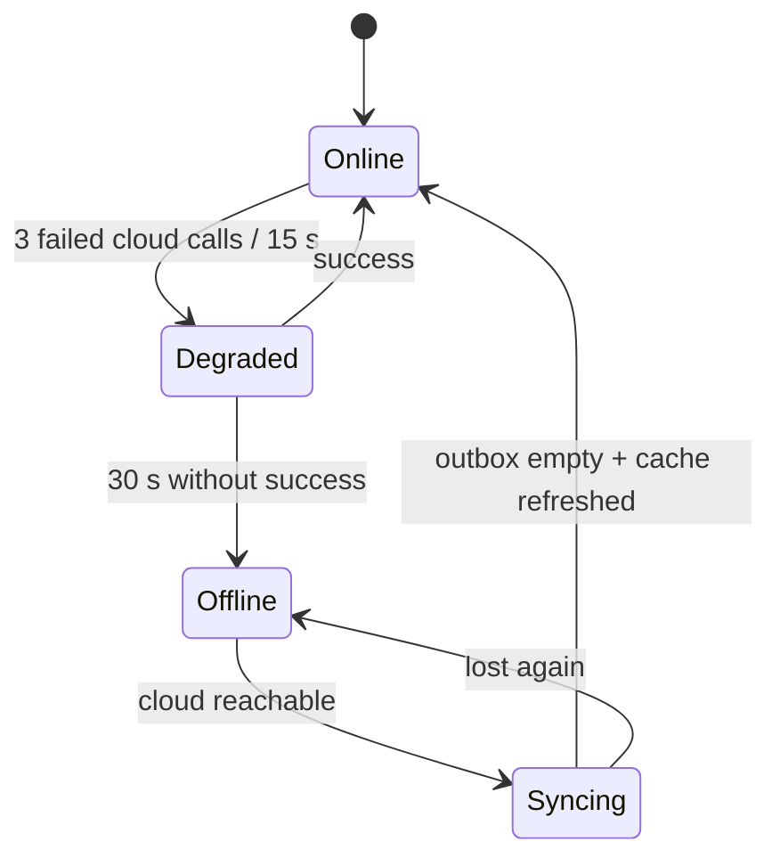
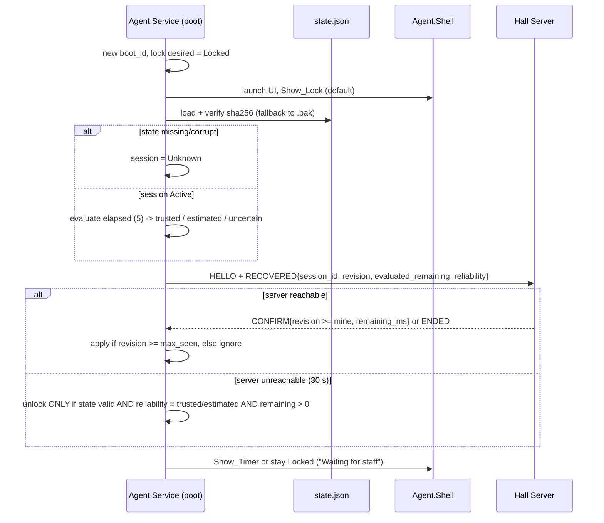

# Windows Agent — Offline Operations, Financial Consistency & Recovery

**Principle:** the cloud is the final authority. Offline data is **provisional** until the sync result is `applied`. Nothing offline automatically overrides a confirmed cloud reservation or a finalized financial record.

## 1. Connectivity modes (Hall Server)



Tracked fields: `last_successful_cloud_sync_at`, `reservation_cache_updated_at`, `reservation_cache_valid_until`, `pricing_cache_version`, `outbox_pending_count`.

## 2. Per-operation policies

| Operation | Online | Offline | Notes |
|---|---|---|---|
| **Continue a running session** | Normal | ✅ The agent's monotonic countdown keeps running. The server keeps its own record | Works even without the server (§6) |
| **Start a new session** | Normal (cloud RPC) | ✅ **Only if** the reservation cache is fresh (§3) and the device is free until `min(valid_until, now + duration)` | Stores a pricing snapshot. Amount is provisional |
| **Extend** | Normal | ✅ Only within the free window known from the cache. `session_revision` + 1 | Capped by the next cached reservation |
| **End** | Normal | ✅ Recorded locally with time-reliability info | The final invoice is created in the cloud at sync |
| **Create a reservation** | Normal | ❌ **Disabled** | Future scope |
| **Cancel or modify a reservation** | Normal | ❌ Disabled | |
| **Payments or cash collection** | Normal | ⚠️ Recorded as a *provisional cash receipt* linked to the local session | Never marked as a final payment until sync |
| **Remote commands (lock/unlock/power)** | Through the cloud | ✅ From the local page (the employee needs `device.control` in the offline pass) | Audited and synced as `COMMAND` operations |
| **Price or package changes** | Normal | ❌ Not possible offline | |
| **Employee login** | Online only | ❌ Never | Offline pass from an earlier online sign-in |

## 3. Reservation cache freshness
- The cache holds confirmed or pending reservations for the hall from `now − 1 h` to `now + 24 h`, refreshed every 60 s and on every Realtime reservation event.
- `reservation_cache_valid_until = reservation_cache_updated_at + 15 min` (configurable per hall, 5–60 min).
- **Fresh** (`now_trusted < valid_until`): an offline start or extend is allowed if there's no reservation on the device overlapping `[now, min(valid_until, now + requested))`. A requested duration that crosses `valid_until` is allowed only up to `valid_until`. Extending past that point needs the cache to be fresh again.
- **Expired:** **offline starts are blocked.** Running sessions continue, and extends are allowed only inside a window already proven free while the cache was fresh.
- **Manager override** (when the cache has expired):
  - Requires the `session.offline_override` permission in the offline pass (manager role or above) and a mandatory reason.
  - Valid for one session, max 60 min, not extendable without another override.
  - Recorded as an `OVERRIDE` operation with `{employee_id, reason, cache_age_ms, device_id}`. It's written to the local audit log, synced, and the resulting session is **always routed to cloud conflict review**, even if no conflict is found.
- If `time_reliability = uncertain`, starts are blocked and overrides aren't allowed.

## 4. Session revision durability
- **Hall Server:** the `local_sessions` table (SQLite, WAL, `synchronous=FULL`) stores `session_id, device_id, revision, state, start/end anchors, pricing_snapshot_id`. Every revision bump is committed **before** the command is sent.
- **Agent:** `state.json` + `state.json.sha256` under `%ProgramData%\Arcadia\Agent\`, ACL SYSTEM-only. Written by write-temp, flush (`FileOptions.WriteThrough`), then `File.Replace` with a backup. Contents: `max_seen_revision`, the session record, `last_device_seq`, `pending_power`, `boot_id`, time anchors.
- **On server recovery:** `next_revision = max(server DB, cloud last-known, agent-reported) + 1`. See the contract doc §4.

## 5. Time reliability

| Clock | Source | Survives reboot | Can be changed by a user | Use |
|---|---|---|---|---|
| Wall clock (local) | `DateTime.Now` | Yes | Yes (admin, or via a policy gap) | Display only |
| UTC (local) | `DateTime.UtcNow` | Yes | Yes | Timestamps, corrected by the offset |
| Monotonic | `Stopwatch.GetTimestamp` / QPC, `Environment.TickCount64` | **No (resets on boot)** | No | Countdown within one boot |
| Server time | Hall Server UTC, synced to cloud time when online | — | — | Authoritative while offline |
| Cloud time | Postgres `now()` | — | — | Final authority |
| Boot time | WMI `LastBootUpTime` + a `boot_id` (random GUID written by the service on first start in a boot) | — | — | Detects a reboot |

**Anchors stored for each session (agent and server):** `start_at_server_utc`, `duration_ms`, `boot_id`, `mono_at_start`, `wall_utc_at_start`, `checkpoint{elapsed_ms, wall_utc, mono}` written every 15 s.

**Elapsed-time evaluation**
- **Same boot:** `elapsed = checkpoint.elapsed + (mono_now − checkpoint.mono)`. Fully trusted.
- **After a reboot** (the monotonic clock reset): `elapsed_est = checkpoint.elapsed + (wall_utc_now − checkpoint.wall_utc)`.
  - **Trusted** if the server is reachable and its time agrees with the local UTC within ±120 s. In that case the agent uses `server_now − start_at_server_utc` directly, which is better.
  - **Estimated** if the server is unreachable but no clock-change event was recorded and the estimate falls between `checkpoint.elapsed` and `checkpoint.elapsed + (now − last_shutdown_time)`.
  - **Uncertain** otherwise.

**Detecting clock changes**
- `SystemEvents.TimeChanged` (hidden message window in the service).
- Every 5 s the service compares `Δwall` with `Δmono`. A difference above 5 s produces `CLOCK_EVENT{delta_ms}` to the server and an audit entry.
- The agent-to-server offset is measured on every heartbeat (NTP-style midpoint). Drift above 120 s → `time_reliability = estimated`, and the offset is used for expiry checks.
- The server-to-cloud offset is measured on every successful call. If the cashier PC's clock is off by more than 120 s from the cloud, the server raises a banner and corrects timestamps at sync using `clock_offset_ms_at_op`.

**Safe fallback when the time is uncertain**
- The agent **never extends** and **never auto-unlocks**.
- An active session is treated as ending at the **earliest plausible end time**. If that has passed, the agent locks and marks the session `Unknown` / `TIME_UNCERTAIN`.
- Staff can resume the session from the local page or the cloud: a new revision is issued with an explicit remaining time, and the action is audited.

## 6. Agent reboot recovery



Rules:
1. The lock state at boot is always **Locked** until the evaluation finishes. The UI starts in lock mode before the network is up.
2. No auto-unlock when the session state is `Unknown`, the state file is corrupt with no valid backup, or the time is `uncertain`.
3. If the persisted session has `revision < server revision`, the server's version wins. If the server reports a revision lower than the agent's `max_seen`, the agent keeps its own and flags `REVISION_REGRESSION` (this indicates a server restored from an old backup).
4. A `pending_power` record is reconciled as described in the contract doc §5.

## 7. Sync and conflict resolution (on reconnect)

```mermaid
sequenceDiagram
  participant H as Hall Server
  participant C as Cloud
  H->>C: fetch_cache(since)  (pricing, reservations first)
  loop outbox in order (occurred_at, seq)
    H->>C: sync_offline_ops([batch of 50])
    C->>C: insert offline_ops(client_op_id UNIQUE) ON CONFLICT -> duplicate
    C->>C: check overlap with confirmed reservations
    alt no conflict
      C->>C: create/extend/end session with pricing_snapshot; mark invoice DRAFT->final at end
      C-->>H: applied {cloud_session_id}
    else conflict
      C->>C: create session as provisional + conflict_review row
      C-->>H: conflict {review_id}
    end
  end
  H->>H: mark outbox ops terminal; map local->cloud ids
```

- **Conflicts with a confirmed cloud reservation** (for example, a booking made online after the cache went stale): the session is recorded, because it physically happened, but it isn't billed as final and the reservation isn't altered. Both go to a **conflict review queue** in the dashboard, where staff choose to reschedule or notify the customer, accept the session invoice, or adjust it.
- **Pricing during offline:** each offline session references an immutable `pricing_snapshot` (`rules`, `packages`, `windows`, `pricing_version`, `captured_at`). The cloud computes the final invoice **with the snapshot**. If the cloud's current `pricing_version` differs, the invoice gets `priced_from_offline_snapshot = true` and is listed for review. It is never repriced automatically.
- **Provisional vs final:** local amounts live in `provisional_charges` (Hall Server) and the cloud `offline_ops.payload`. Final invoices are created only by cloud RPCs. The dashboard shows offline-originated invoices with a badge.
- **Duplicates and uncertain results:** if a sync request times out, the server re-sends the same `client_op_id`s. The database's `UNIQUE(client_op_id)` returns `duplicate` with the original result, so an operation is never applied twice.

## 8. Hall Server availability and recovery

| Concern | Design |
|---|---|
| Startup | Windows Service, `Automatic (Delayed Start)` off, so it starts early. SCM recovery: restart after 5 s, 10 s, then 30 s, and reset the counter after 1 day |
| Health | `/health` (process, DB, cloud reachability, agents connected), watchdog thread. Agents alert when the server heartbeat is missing for more than 30 s |
| SQLite integrity | WAL, `synchronous=FULL`, `PRAGMA quick_check` at startup and `integrity_check` nightly. On failure: switch to the latest backup, then re-sync from the cloud |
| Backups | Online `VACUUM INTO` hourly, kept 48 h locally plus a daily copy to a second disk or USB. Cloud pull on restore |
| Safe shutdown | Handles `SERVICE_CONTROL_PRESHUTDOWN`: finish the current transaction, checkpoint WAL, notify agents `SERVER_GOING_DOWN` |
| Power loss | WAL plus FULL sync means no committed operation is lost. UPS strongly recommended (documented hardware requirement) |
| Cashier PC failure | Agents continue running sessions locally (below). The dashboard shows the server offline after 90 s |
| Restore on a replacement PC | 1) Revoke the old server credential in the dashboard. 2) Install HallServerSetup.msi. 3) Pair with a new one-time code. 4) Restore the latest backup if available, otherwise the cloud state. 5) **Re-pair agents** (new CA). Agents get a "re-pair" prompt for a technician. 6) Revision recovery as in §4. Runbook target time: ≤30 min |

**When the Hall Server is unavailable, agents can still:**
- continue active sessions on their monotonic timer and lock at the end;
- show the lock or timer UI;
- accept a technician emergency unlock or end on the PC itself (audited locally and uploaded later).

**They can't do (disabled):**
- start, extend or end sessions from the local page;
- receive remote commands (lock, unlock, power) from the cloud;
- accept any new revision.

**Explicit MVP limitation:** no HA or standby server. While the cashier PC is down *and* the internet is up, staff still can't start sessions on the PCs, because all commands flow through the Hall Server. A future option is a direct cloud fallback.

## 9. Lock-timing acceptance (separated causes)

| Scenario | Expected behaviour | Target | How it's measured |
|---|---|---|---|
| Normal local execution (service and UI healthy) | Overlay visible on all monitors after end_at | **p95 ≤ 2 s** | Harness: the agent logs `mono` at end_at and on overlay-rendered (WPF `ContentRendered` + DWM flush). 200 runs |
| Cloud-issued LOCK (online) | End-to-end from the web click to Locked | p95 ≤ 5 s | Timestamps across web, cloud, server and agent |
| Hall Server down | Session end still locks locally | ≤ 2 s (same as local) | Unplug the server, then the harness |
| Agent.Shell crash | Service relaunches the UI ≤ 3 s, otherwise `LockWorkStation`, then logoff | ≤ 3 s | Kill the process in the harness |
| Agent.Service crash | **No enforcement** until SCM restarts it (5 s) and recovery runs | Not guaranteed. Alert to staff after a 30 s heartbeat gap | Measured for the restart, **manual** for the enforcement gap |
| Windows UI failure (DWM or explorer hang) | Fallback `LockWorkStation` or logoff | Best effort | Manual test |
| PC hardware failure or power loss | Nothing runs. The session is marked Unknown on the server after the offline threshold | — | **Manual intervention only** |
