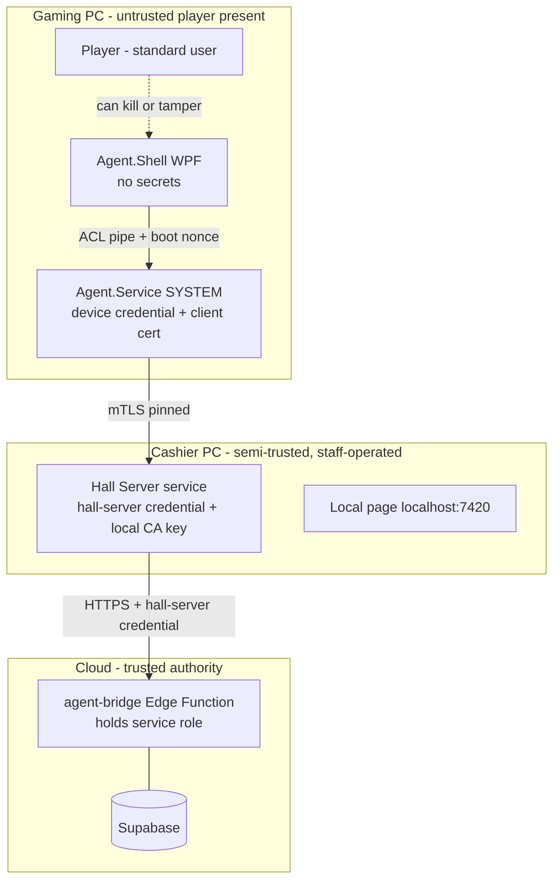

# Windows Agent — Security Model

## 1. Trust boundaries



**Rules**
- **Assume the player is hostile** on the gaming PC. The UI holds no secrets, and everything it says is advisory.
- **Assume the LAN is hostile:** other devices and guests' phones may be on the same Wi-Fi.
- **No service-role key or privileged DB key on any PC.** The cloud is reached only through `agent-bridge`, which authenticates the hall-server credential and calls `security definer` RPCs scoped to that hall.

## 2. Credentials and lifecycle

| Credential | Issued by | Where it's stored | Lifetime | Rotation | Revocation |
|---|---|---|---|---|---|
| **Hall pairing code** | Dashboard (owner, `hall.settings.manage`) | Shown once and stored as a hash in the cloud | **One-time, 10 min**, scoped to the hall (and branch) | New code on demand | Expires automatically. Can be deleted |
| **Hall Server credential** | Cloud during server pairing (one-time code) | DPAPI LocalMachine + file ACL (SYSTEM, Administrators) | 90 days, rolling | Automatic refresh while online | Dashboard "Revoke server" → `hall_servers.revoked_at`, then all calls are rejected |
| **Local CA** (per Hall Server) | Generated on first run | PFX protected with DPAPI | 5 years | On server replacement (re-pair all agents) | Revoking the server invalidates the CA |
| **Device credential + client certificate** | Hall Server, during agent pairing with the hall pairing code | Agent: DPAPI LocalMachine + ACL; cloud: `agents.token_hash`, certificate fingerprint | 1 year certificate, 90-day token | Rolled automatically by the server | Dashboard "Unpair" → cloud `agents.revoked_at`, then the server drops the connection and the certificate is denied |
| **Offline pass** | Cloud, while an employee is signed in online | Browser storage (httpOnly cookie on the local origin, set through a signed handoff) | **≤12 h**, ends at the end of the shift | Re-issued on each online page load | Server checks a revocation list synced from the cloud. Employee removal revokes it |
| **Technician credential** | Owner sets it in the dashboard | Stored as a hash (Argon2id) on the Hall Server and the agents | Until changed | Manual | Changing it in the dashboard propagates |

Pairing flow:

```mermaid
sequenceDiagram
  participant O as Owner (dashboard)
  participant C as Cloud
  participant H as Hall Server
  participant A as Agent (new PC)
  O->>C: Generate hall pairing code (10 min, one-time)
  A->>H: Discover (mDNS hint or manual IP), TLS with server cert
  A->>A: Show server fingerprint; technician confirms against the dashboard
  A->>H: PAIR {pairing_code, machine_fingerprint, CSR}
  H->>C: agent_register(code, device_id chosen, fingerprint)
  C-->>H: ok + device_id (code consumed)
  H-->>A: client cert (signed by local CA) + device token + CA pin
  Note over A: hall code is never stored; only the device credential
```

## 3. Mutual authentication and LAN encryption
- Every agent↔server connection uses **TLS 1.3 mTLS**. The server certificate is signed by the local CA, and **the agent pins the CA public key** at pairing. Each agent's client certificate is checked against the server's device registry (fingerprint, then `device_id`).
- **mDNS spoofing:** a discovery result is only a hint about *where* to connect. Identity is proven only by the pinned CA, so an impostor can't complete the TLS handshake. On first pairing, the technician compares a short fingerprint shown in the dashboard with the one shown on the agent.
- Messages also carry `hall_id`, `device_id` and a monotonic `seq`. The server rejects any mismatch with the certificate identity.

## 4. Local IPC (service ↔ UI)
- A named pipe `\\.\pipe\arcadia-agent-{bootId}` created with `NamedPipeServerStreamAcl`: allow SYSTEM full control, allow the **configured player SID** read/write, deny everyone else.
- The service launches the UI itself and passes a **per-boot nonce** on the command line through an inherited handle, not a visible argument. The UI must present it.
- Closed message set:

  | Direction | Messages |
  |---|---|
  | Service → UI | `Show_Lock{hall_name, logo_path, device_name, status}`, `Show_Timer{remaining_ms, revision}`, `Warn{kind, seconds}`, `Hide` |
  | UI → Service | `Ack{msg_id}`, `UiHeartbeat`, `TechUnlockRequest{pin_attempt}` (rate-limited, 5 tries a minute) |

- The pipe and the cloud have **no remote shell, PowerShell, arbitrary file or exec message**. Power operations are fixed enum commands executed by the service only.

## 5. Administrative separation
| Actor | Can | Can't |
|---|---|---|
| Player (standard user) | Use games/apps allowed by the GPO baseline | Stop services, edit HKLM/ProgramData, change time, open the pipe beyond the UI role |
| Agent.Shell | Display state, collect a technician PIN attempt | Unlock by itself, access credentials |
| Agent.Service | Lock, unlock, log off, shut down, restart, persist state | Execute arbitrary code, change policies |
| Technician (local credential) | Emergency unlock or end on one PC (audited), re-pair | Change pricing or invoices |
| Hall Server | Relay commands, issue revisions, offline operations | Create final invoices, mint cloud permissions |

**Windows policy changes are never applied automatically.** The GPO baseline is a manual checklist in this repo, written later and reviewed by the owner.

## 6. Local offline page (Hall Server :7420)
- Binds to `127.0.0.1` by default. LAN binding is an explicit opt-in.
- **Origin/Host check:** only `http://localhost:7420` or the configured host. Requests with any other `Origin` or `Referer` are rejected.
- **CSRF:** a synchronizer token on every state-changing request, plus `SameSite=Strict` httpOnly cookies.
- **Offline pass** (see §2): JWT signed by the cloud with Ed25519, public key cached on the server. Claims: `sub` (employee), `hall_id`, `branch_id`, `perms[]`, `exp ≤ 12h`, `jti`.
- **Replay:** each state-changing request carries a fresh `op_nonce`. The server stores used nonces until `exp`, and duplicates are rejected.
- The pass works **only** for an employee who signed in online beforehand. Offline login doesn't exist.

## 7. Tenant and branch isolation
- Every credential is bound to one `hall_id` (tenant) and optionally one `branch_id`. Every RPC rechecks `hall_id`/`branch_id` against the credential, never against a request field alone.
- The Hall Server holds data only for its own hall.

## 8. Audit
Every privileged action produces an audit record, locally (append-only SQLite table with a hash chain) and in the cloud `audit_log` after sync:
- Each command, with requester, source (cloud, local page or technician) and result.
- Each technician unlock.
- Each cache override.
- Pairing, unpairing and revocation.
- Detected clock changes.

## 9. Updates (future)
- MSI and EXE are signed with Authenticode. The agent checks the signature and publisher before applying an update.
- Staged rollout per hall, keep N-1 for rollback, health check after the update, automatic rollback on failure.

## 10. Threat table

| Threat | Mitigation | Residual risk |
|---|---|---|
| Player kills the UI | Service relaunches it in ≤3 s, otherwise LockWorkStation or logoff | Brief flash of the desktop |
| Player stops the service | Standard user can't. SCM recovery. Server alerts after a heartbeat timeout | Physical access or boot media → hardware or BIOS password (manual) |
| Player changes the clock | GPO denies it. The service detects changes (see offline doc §5) and falls back safely | — |
| Fake Hall Server through mDNS | Pinned CA, mTLS | — |
| Stolen device credential | Bound to the certificate and machine fingerprint, can be revoked, 90-day rotation | Window until it's revoked |
| Compromised cashier PC | Server credential is scoped to one hall and can't create invoices. Revoke and re-pair | Local operations during the compromise must be reviewed |
| Replay of an offline operation | `client_op_id` unique in the DB, `op_nonce` | — |
| CSRF on the local page | Origin check, CSRF token, SameSite | — |
| Leaked service-role key | Never on a PC | — |
| Missed Realtime event | Durable pull with a cursor and reconciliation | — |
